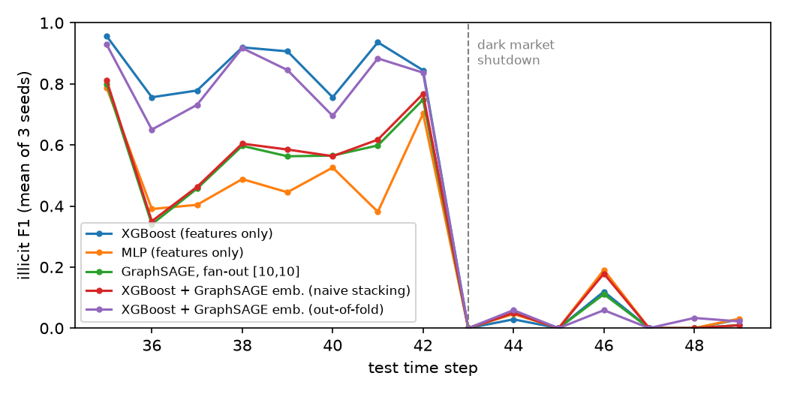

# gnn-mini: GraphSAGE on the Elliptic Bitcoin transaction graph

Illicit-transaction detection with PyTorch Geometric. The project is deliberately small. It compares feature-only
models with GraphSAGE (mini-batch neighbor sampling via `NeighborLoader`) and with XGBoost stacked on GraphSAGE
embeddings, under a strict temporal split. All numbers below come from `results/*.json` (run 2026-11-02 on a Mac
M4 Pro CPU).

## Setup

- **Data:** PyG `EllipticBitcoinDataset`: 203,769 transactions (nodes), 234,355 payment flows (edges, made
  undirected), 49 time steps and 165 features. Labels: 4,545 illicit, 42,019 licit and 157,205 unknown.
- **Split:** train steps 1–29 (26,381 labelled), val 30–34 (3,513), test 35–49 (16,670). The test set is the same
  as in Weber et al. 2019. That paper trains on steps 1–34 without a val set.
- **Point-in-time:**
  - No edge connects two different time steps (asserted in `load_data`), so a node's neighbourhood never contains
    future transactions.
  - Feature standardisation uses training-period statistics only.
  - Unknown nodes take part in message passing but not in the loss or the metrics.
- **Training and thresholds:**
  - Class weights are 0.3/0.7 (licit/illicit), as in the paper.
  - Early stopping uses val PR-AUC.
  - The decision threshold maximises F1 on val and is then frozen for test.
- **Models:**
  - XGBoost on features only.
  - MLP: 2 layers, 128 hidden units.
  - GraphSAGE: 2 `SAGEConv` layers, 128 hidden units, fan-out [10,10], batch 1024. Inference uses all neighbours.
  - XGBoost on features plus GraphSAGE embeddings, in two versions:
    - **Naive:** train-node embeddings come from the GNN trained on those same labels.
    - **Out-of-fold:** the training steps are split into 5 folds by `time_step % 5`. Each fold is embedded by a
      GNN trained on the other folds; val and test embeddings come from the GNN trained on all training steps.

## Results (test steps 35–49, illicit class, mean ± std over 3 seeds)

| Model | Precision | Recall | F1 | PR-AUC |
|---|---|---|---|---|
| XGBoost (features only) | 0.796 ± 0.015 | 0.734 ± 0.001 | **0.764 ± 0.007** | **0.792 ± 0.001** |
| MLP (features only) | 0.501 ± 0.016 | 0.512 ± 0.027 | 0.506 ± 0.020 | 0.350 ± 0.043 |
| GraphSAGE [10,10] | 0.569 ± 0.020 | 0.572 ± 0.015 | 0.570 ± 0.017 | 0.547 ± 0.033 |
| XGBoost + GraphSAGE emb., naive stacking | 0.576 ± 0.022 | 0.586 ± 0.020 | 0.581 ± 0.020 | 0.608 ± 0.039 |
| XGBoost + GraphSAGE emb., out-of-fold | 0.796 ± 0.111 | 0.701 ± 0.027 | 0.740 ± 0.039 | 0.776 ± 0.002 |

For reference, Weber et al. 2019 (same test steps, all features) report illicit F1 of 0.788 for Random Forest,
0.796 for RF + GCN embeddings, 0.653 for MLP and 0.628 for GCN.

**GraphSAGE fan-out trade-off** (CPU, 8 threads; time per training epoch, mean of 3 seeds):

| Fan-out | Test F1 | Test PR-AUC | s / epoch | sampling | fwd+bwd |
|---|---|---|---|---|---|
| [5,5] | 0.565 ± 0.010 | 0.542 ± 0.030 | 0.30 | 0.05 | 0.26 |
| [10,10] | 0.570 ± 0.017 | 0.547 ± 0.033 | 0.37 | 0.05 | 0.32 |
| [25,10] | 0.548 ± 0.008 | 0.512 ± 0.016 | 0.41 | 0.06 | 0.35 |
| all neighbours | 0.554 ± 0.019 | 0.509 ± 0.033 | 0.61 | 0.07 | 0.54 |

**Batch embedding generation:** all 203,769 nodes with full neighbours (batch 4096) take 0.30 s, about 715k
nodes/s. Each embedding file in `embeddings/` stores its config and training period.



## Observations

1. **The graph helps the neural model:** GraphSAGE beats the MLP on the same features (F1 0.570 vs 0.506, PR-AUC
   0.547 vs 0.350). Gradient-boosted trees on the 165 features remain the strongest single model, which matches
   the paper's finding that RF beats GCN.
2. **Naive stacking leaks labels:** naive stacking drops XGBoost from 0.764 to 0.581 F1. The training-node
   embeddings encode labels that the GNN has already fit, so XGBoost leans on them; they do not transfer to test.
   Out-of-fold embeddings remove most of the gap (0.740 F1, 0.776 PR-AUC), but they do not beat feature-only
   XGBoost here (seed 1's val-chosen threshold costs precision; PR-AUC, which does not depend on the threshold, is
   0.776 vs 0.792).
3. **Wider sampling does not pay off:** fan-out [10,10] is as accurate as full-neighbour training at 0.61× the
   epoch time. Sampling plus feature gathering is only about 15% of the epoch; forward and backward dominate on
   this small graph.
4. **Every model fails after the shutdown:** after the dark-market shutdown at step 43, illicit F1 falls to near 0
   for every model, as the paper reports. This is concept drift; no model here handles it.

Limitations: hyper-parameters were not tuned (MLP and GraphSAGE are below the paper's MLP/GCN), the results are
CPU-only, and Elliptic is small. Neighbor sampling is used to exercise the same pipeline that a large graph would
need, not because this graph requires it.

## Reproduce

```bash
uv sync      # torch 2.12 + pyg-lib 0.7; pyproject pins the macOS arm64 pyg-lib wheel,
             # on Linux swap in the matching wheel from https://data.pyg.org/whl/
./run_all.sh  # all models x 3 seeds + fan-out sweep, then summarize.py -> results/summary.md
```

XGBoost runs in a subprocess (`xgb_worker.py`) because the torch and xgboost wheels bundle different OpenMP
runtimes that segfault in one process on macOS.
